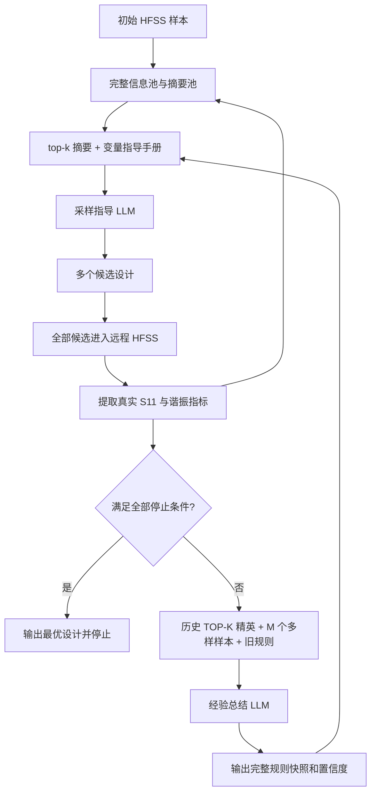

# LLMO Frame 1：LLM 辅助双频天线闭环优化框架

> 当前版本已移除神经网络代理模块。每轮采样 LLM 产生的全部候选会通过本项目自带的 `client_submitter.py` 提交 ele_sim 数据库，由远程 `plugins/worker_simulation.py` 调用 `plugins/_lib/cpw_hfss_runner.py` 逐个执行 HFSS；所有真实返回曲线都会进入样本池，下一轮 LLM 直接读取这些结果。

本项目使用两个智能体优化双频偶极子天线：采样设计智能体提出候选变量，经验总结智能体从已评估样本提炼设计指导，二者共同推动后续搜索。HFSS 是固定的物理仿真与评估环节，为每个候选返回真实响应；两个智能体共同承担优化器的工作，项目不使用神经网络代理模型。

设计目标是让天线在 `2.45 GHz` 与 `4.50 GHz` 附近分别形成实际谐振，并使两个固定目标频点处的 `S11` 达到设定阈值。实际阈值、权重、模型、路径和迭代参数均位于 [project.conf](project.conf) 配置树中。

> 说明：原始问题对 `s3` 的文字描述再次写成了“上半部缝隙宽度”。本项目按 `s1=上半部、s2=中间、s3=下半部` 的结构关系，将 `s3` 定义为下半部缝隙宽度。

## 1. 框架做了什么

启动方式由 `project.use_initial_parquet` 控制。默认 `true` 会导入 `project.initial_parquet` 中的 40 条真实 HFSS 样本，并原样使用现有采样与经验提示词。设为 `false` 会跳过该文件，从空样本池开始；第一轮采样 LLM 根据电磁知识和变量范围提出探索候选。后续每轮采样取实际已有样本与 `optimization.top_k` 中的较小数量，经验总结取实际已有样本与 `optimization.top_q` 中的较小数量。零样本模式使用 `prompts/sampling_guidance_zero.md` 和 `prompts/experience_summary_zero.md`，提示词里的样本数量随实际数量变化；样本不足时经验 LLM 可在摘要中提出标记为未验证假设的目标导向设计建议，正式规则仍需实测证据。

临时切换示例：`python main.py --config project.conf --set project.use_initial_parquet=false`。两种模式应使用不同的新运行目录；零样本模式拒绝恢复包含初始 Parquet 样本的目录。`--validate-only` 在零样本模式下也不读取初始 Parquet。



每条入池样本都显式携带 `source`，但发送给两个 LLM 的紧凑样本行只保留 `rank`；持久化样本 ID、来源和迭代号留在代码内部。采样 LLM 使用摘要池的 TOP-K，经验 LLM 使用按排名分数截取的 TOP-Q（配置键为 `optimization.top_q`）；两者都不额外加入多样性样本。采样候选的 rationale 和 rules_used 不进入经验 Prompt。代码不再自动升级置信度。mock 数据只用于软件流程测试。

## 2. 九个设计变量

代码、配置、JSON 数据和模型提示词中的变量名全部使用小写。

| 变量 | 范围（mm） | 物理含义 |
|---|---:|---|
| `a` | 100–150 | 基板长度 |
| `b` | 40–80 | 基板宽度 |
| `l1` | 15–45 | 上半部缝隙长度 |
| `l2` | 5–15 | 中间缝隙长度 |
| `l3` | 15–45 | 下半部缝隙长度 |
| `s1` | 0.5–1.5 | 上半部缝隙宽度 |
| `s2` | 2–10 | 中间缝隙宽度 |
| `s3` | 0.2–1.6 | 下半部缝隙宽度 |
| `f_l` | 5–15 | 馈线长度 |

框架不再把全局范围机械分成三个区域。摘要池和两个 LLM 都读取连续变量值，例如：

```json
"l1": 31.2
```

经验模块根据真实样本自己提出规律的连续适用范围，例如 `l1:[26.40,34.20]`。这种范围仍是证据支持的适用域，不是处处成立的硬约束，也不会被解释成精确物理定律。

## 3. 为什么将 S11 拆成四个指标，以及如何表示 0/1/2 个谐振

对每个目标频段，框架同时区分“实际谐振在哪里”和“固定目标频点处匹配有多深”：

| 指标 | 原始物理量 | 优化解释 |
|---|---|---|
| `low_resonance_point` | 低频实际谐振频率 | 与 2.45 ghz 的距离是否减小 |
| `s11_at_2_45` | 2.45 ghz 处的固定频点 S11 | 是否变得更负并达到阈值 |
| `high_resonance_point` | 高频实际谐振频率 | 与 4.50 ghz 的距离是否减小 |
| `s11_at_4_50` | 4.50 ghz 处的固定频点 S11 | 是否变得更负并达到阈值 |

规则现在直接记录物理移动方向，而不再把它编码成“变好/变坏”。例如，实际低频谐振从 `2.30 ghz` 移到 `2.40 ghz` 记为 `low_resonance_point:h`，表示频率向高频移动；从 `2.60 ghz` 移到 `2.50 ghz` 记为 `low_resonance_point:l`，表示频率向低频移动。是否更接近 `2.45 ghz` 由读取规则的人或 LLM 结合目标判断。

每个真实样本还保存 `resonance_count`，其值只可能是 `0`、`1` 或 `2`。为便于完整池的稳定存储，谐振数据固定使用两个槽位：

| `resonance_count` | 第一个槽位 | 第二个槽位 | 含义 |
|---:|---|---|---|
| `2` | 较低频率谐振及其真实 S11 | 较高频率谐振及其真实 S11 | 检出了两个相互独立的谐振。 |
| `1` | 唯一谐振及其真实 S11 | 频率 `0`、S11 `0` | 只检出了一个有效谐振。 |
| `0` | 频率 `0`、S11 `0` | 频率 `0`、S11 `0` | 未检出有效谐振。 |

这里的 `0` 是“该槽位没有谐振数据”的哨兵值，不表示 `0 ghz` 处真实发生了谐振，也不表示真实 S11 为 `0 db`。当 `resonance_count=1` 时，唯一谐振放入第一个槽位；因此必须先读 `resonance_count`，不能仅根据字段名认定它属于低频目标。

固定双槽位只用于完整池、摘要池和旧项目恢复。发送给采样 LLM 与经验总结 LLM 时，代码会生成动态紧凑视图，不再发送缺失槽位及其 `0` 哨兵。几何变量直接使用连续数值：

```text
{rank:1}
+ {geom:{a:125.00,b:60.00,l1:30.00,l2:10.00,l3:30.00,s1:1.00,s2:5.00,s3:0.90,f_l:10.00}}
+ {n_res:2}
+ {res:[[2.48,-15.40],[4.47,-15.70]]}
+ {target_s11:{2.45:-12.80,4.50:-13.90}}
+ {score:0.670000}
```

这里的 `+` 只是字段分段连接符，不是数学加法。`geom` 中数值单位为 mm；`res` 中每一项为 `[实际谐振频率 ghz,该点 S11 db]`，并按频率升序排列。三种动态形式为：

```text
{n_res:0} + {res:[]}
{n_res:1} + {res:[[4.48,-15.25]]}
{n_res:2} + {res:[[2.48,-15.40],[4.47,-15.70]]}
```

程序强制检查 `n_res == len(res)`。`source` 只保存在内部样本池和审计数据中，不发送给 LLM。`target_s11` 始终单独保存两个固定目标频点处的插值结果，不能与实际谐振谷深度合并。

详细符号规则、模板与示例位于 [docs/variable_interaction_rules.md](docs/variable_interaction_rules.md)。该文件及两个提示词模板全部采用英文，便于直接输入模型。

## 4. 样本双池

### 4.1 完整信息池

每次启动都会在配置的 `runtime_dir` 基础名称后追加 `_MMDD_HHMM` 时间戳（例如 `runtime_0831_2017`）；同一分钟重复运行会继续追加 `_01`、`_02`，因此不同运行不会互相覆盖。也可以用 `--output-dir experiment_a` 显式创建 `<项目根>/experiment_a`，或用 `--resume-dir experiment_a` 从该已有目录恢复。以下 `runtime/...` 示例均表示本次选定运行目录下的对应文件。

运行后生成：

```text
runtime/complete_information_pool.json
```

JSON 数组中的每个对象保存一个真实样本，包含：

- `sample_id`
- 九个设计变量的真实数值
- 完整 `frequency_ghz` 数组
- 完整 `s11_db` 数组
- `resonance_count`、双谐振标志 `is_dual_resonance`、四个目标指标及两个谐振深度
- 综合得分
- 产生样本的迭代轮数
- 数据来源及初始数据包中需要保留的额外元数据

完整池永久保存初始 Parquet 样本以及每个已经取得有效 HFSS 曲线并完成评分的候选样本。文件始终按得分从高到低排列，同分时按 `sample_id` 升序稳定排列。恢复运行时，程序会核对当前 Parquet 与池内已有初始样本的变量和完整曲线；匹配时保留所有历史候选并继续运行，不匹配时在写入前报错并要求使用新的运行目录，绝不会自动清空历史候选或混合两个初始数据集。

初始数据包会先被整批读取、校验、计算指标并暂存在内存中；只有整批都成功后，程序才同时更新完整池和摘要池，避免后部坏样本造成“只导入了前半批”或两个池不一致。

### 4.2 样本摘要池

运行后生成：

```text
runtime/sample_summary_pool.json
```

摘要池按真实得分从高到低排序，并带有稳定的 `rank`。`optimization.summary_pool_size` 控制文件最多保存多少条最高分摘要，默认值为 40，且必须不小于 `top_k` 和 `top_q`。每个摘要明确保存 `resonance_count`，并按上表写入两个谐振槽位。变量只保存连续数值，不保存人为区域标签；完整曲线和远程任务元数据只保存在完整池。发送给采样 LLM 和经验总结 LLM 的紧凑样本行只保留 `rank`，`sample_id/source/iteration` 留在程序内部用于持久化和审计。

当真实样本数少于 `top_k` 或 `top_q` 时，代码自动使用全部真实样本，不会为了凑足数量复制样本。

## 5. 样本排名分数 R

当前 `score` 只用于样本排序和 TOP-K/TOP-Q 选样，不参与成功判断。成功判断直接检查双谐振、实际谐振频率误差以及两个目标频率处的 S11 阈值。

实际谐振位置质量为：

$$
q_{f,L}=\exp\left(-\frac{|f_{r,L}-f_L^\star|}{\tau_f}\right),\qquad
q_{f,H}=\exp\left(-\frac{|f_{r,H}-f_H^\star|}{\tau_f}\right)
$$

$$
q_f=\frac{q_{f,L}+q_{f,H}}{2}
$$

其中 \(f_{r,L},f_{r,H}\) 是从 HFSS 曲线检测出的实际谐振频率，\(f_L^\star,f_H^\star\) 是配置中的目标频率 2.45 GHz 和 4.50 GHz，当前 \(\tau_f=0.05\) GHz。

固定目标频率处的 S11 质量为：

$$
q_{\mathrm{band}}(s)=\operatorname{clip}\left(\frac{-s}{|s_{\mathrm{excellent}}|},0,1\right)
$$

$$
q_s=w_Lq_{\mathrm{band}}(S_{11}(2.45)) + w_Hq_{\mathrm{band}}(S_{11}(4.50))
$$

当前 \(s_{\mathrm{excellent}}=-20\) dB、\(w_L=w_H=0.5\)。最终排名分数为：

$$
R=0.6q_f+0.4q_s
$$

这里的 \(S_{11}(2.45)\) 和 \(S_{11}(4.50)\) 是固定目标频率处的插值值，不是实际谐振谷底处的 S11。实际谐振点只通过 \(q_f\) 影响排名。

### 5.1 可调系数总览

影响优化结果或计算开销的参数均集中在 `project.conf`，每个键旁边都有中文注释。最常调的项目如下：

| 类别 | 配置键 | 默认值 | 调节作用 |
|---|---|---:|---|
| 排名分数 | `score.low_band_weight` / `high_band_weight` | 0.5 / 0.5 | (q_s) 中两个目标频段的相对权重。 |
| 排名分数 | `score.excellent_s11_db` | -20 | 单频段达到满分的 S11 参考值。 |
| 排名分数 | `score.resonance_error_scale_ghz` | 0.05 | 实际谐振频率误差的指数质量尺度。 |
| 排名分数 | `score.frequency_weight` / `s11_weight` | 0.6 / 0.4 | \(R\) 中实际频率质量和目标频率 S11 质量的权重。 |
| 重复修复 | `optimization.duplicate_perturbation_alpha` | 0.10 | 重复候选扰动公式中的 \(\alpha\)。 |
| 重复修复 | `optimization.duplicate_perturbation_max_attempts` | 100 | 一个重复候选的最大扰动尝试次数。 |
| 谐振检测 | `antenna.resonance_detection.*` | 见配置 | 谐振间距、突出度、鞍部回升、平滑窗口、谷底细化和输出精度。 |
| 远程仿真 | `remote.*` | 见配置 | ele_sim 数据库路由、任务超时、重试和批次等待参数。 |
| LLM | `llm.*` | 见配置 | 请求重试、超时、温度、token、预检和 system prompt。 |
| HFSS | `llmo/hfss_runner.py` 固定常量 | 与 PSO runner 对齐 | 材料、基板、CPW、铜厚、空气盒、端口、参考阻抗、Setup 和 Sweep。 |
| mock | `simulation.mock.*` | 见配置 | 软件测试曲线的双谐振位置、深度、宽度和噪声；不代表真实物理。 |

HFSS 固定建模参数不再从 `project.conf` 读取，也不接受 `--set` 覆盖；这样优化算法配置与电磁模型基准严格分离。每个请求只把九个优化变量写入请求 JSON。

## 6. 真正停止需要同时满足的条件

停止与否只由代码在真实仿真完成后判断，LLM 无权自行宣布成功。框架同时检查：

1. 双谐振提取器确认存在两个独立谐振；
2. 低频实际谐振与 2.45 GHz 的距离不超过 `resonance_tolerance_ghz`；
3. 高频实际谐振与 4.50 GHz 的距离不超过 `resonance_tolerance_ghz`；
4. 低频和高频目标频点处的 S11 分别不高于 `antenna.targets.s11_threshold_db`。

排名分数 (R) 不参与上述成功布尔判断。

## 7. 零、单、双谐振提取逻辑

根目录的 [find_resonance_points.py](find_resonance_points.py) 提供局部谷值、突出度、间隔和鞍部判断，并在同一接口中返回单谐振结果。主流程调用 `find_two_resonances`：

- 先对 S11 进行短窗平滑；
- 搜索局部谷值；
- 检查 prominence；
- 检查两个谷值的最小频率间隔；
- 检查两谷之间是否有足够的 saddle rise；
- 没有有效谷值时返回 `resonance_count=0`，两个槽位全为 `0`；
- 只有一个有效谷值，或第二个谷不能通过间隔/鞍部等检查时，保留第一个有效谷并返回 `resonance_count=1`，第二个槽位为 `0`；
- 两个独立谷均通过检查时，按频率排序后返回 `resonance_count=2` 及两个真实谐振点与深度。

所有真实谐振频率和谐振深度统一保留两位小数。主流程还会在 2.45 ghz 和 4.50 ghz 处插值读取固定频点 S11，把计数和两个槽位整理进样本池；最终停止条件仍要求 `resonance_count=2`。

## 8. 远程 Client/Worker 仿真

项目不再使用神经网络代理。采样 LLM 返回的每个候选都会写入 `candidate_proposals.json`，随后由 `client_submitter.py` 通过 `ele_sim` 数据库提交。远程 Worker 使用 `plugins/worker_simulation.py`，并由独立的 `plugins/_lib/cpw_hfss_runner.py` 创建和求解 HFSS 工程。

Client 保留候选顺序，等待整批任务进入终态；每个 Worker 只返回 `frequency_data` 和 `s11_data`。主程序对每条曲线重新计算谐振、固定目标频点 S11 和真实分数，然后将整批真实记录写入完整信息池和摘要池，供下一轮两个 LLM 使用。`pending_remote_batch.json` 在提交后立即记录任务 ID，异常时用于诊断和恢复。

候选与历史样本或同轮候选重复时不会被删除。代码会为每个变量生成一个 \(r_i\in[-1,1]\)，按照

$$
x_i'=\operatorname{clip}\!\left(x_i+r_i\alpha(x_{i,\max}-x_{i,\min}),x_{i,\min},x_{i,\max}\right)
$$

进行扰动，四舍五入并裁剪回合法范围。公式中的 \(\alpha\) 对应 `optimization.duplicate_perturbation_alpha`（默认 0.10），最多尝试次数对应 `optimization.duplicate_perturbation_max_attempts`（默认 100）。扰动后的所有候选都会进入远程 HFSS 批次。

## 9. 两个 LLM 模块

### 9.1 采样指导模块

输入：

- top-k 真实样本摘要；
- 摘要中的九个连续变量值；
- 真实得分、目标频点 S11、`resonance_count`、实际谐振点与谐振深度；
- 当前变量设计指导手册；
- 全局变量范围和目标。

采样输入明确排除每个历史样本的内部标识。候选数量、两个目标频率、S11 阈值和九个变量范围均由配置树实时填入提示词，不在模板中写死。程序只在提示词开头解释一次紧凑样本语法，随后让每个 top-k 样本占一行；不再为每条样本重复长篇英文，也不再向 LLM 暴露固定双槽位或缺失槽位的 `0` 哨兵。采样 Prompt 明确以当前 `variable_design_guidebook` 作为设计指导来源，并在运行时手册正文之前插入“变量设计手册格式说明”，逐项解释 `rule/domain/var_change/effect/confidence/note`、所有符号和完整示例，避免 LLM 只看到规则内容却不了解其格式。

输出必须恰好包含 `proposals_per_iteration` 个完整候选。每个候选包含九个变量、一个可供人类直接阅读的单段 `rationale` 和 `rules_used`；不再输出 `exploration_type`。所有变量统一保留两位小数。代码会检查九个变量是否齐全；合法值被四舍五入到两位，越界值、非数值或非有限值会在对应合法区间中随机重采样，并在日志中记录原值和替换值。JSON 结构由 [prompts/sampling_guidance.md](prompts/sampling_guidance.md) 约束。

### 9.2 经验总结模块

输入：

- TOP-K 分数精英和 M 个设计空间多样真实样本信息；
- 摘要池按真实分数排序得到的 TOP-K 精英，以及从所有剩余设计中按归一化变量距离选择的 M 个样本；多样样本不因分数低而被过滤；
- 当前仍活动的历史交互规则；
- 由配置树实时填入的目标频率、S11 阈值与变量范围；
- 一次性的紧凑样本图例，以及使用同一格式表示的 TOP-Q 样本；
- 符号交互规则的英文示例解读。

输出是下一轮使用的完整规则快照，而不仅仅是新增规则。经验 LLM 可以根据本轮输入保留、修改或移除旧规则，也可以增加新规则。每条规则包含连续适用范围、协同变量变化、四项物理影响、`confidence` 和说明文字；`confidence` 由经验 LLM 根据输入证据直接给出。代码只检查结构、合法范围、符号和 `confidence ∈ [0,1]`，不再维护证据计数、Beta 后验或状态升级。

谐振点影响使用 `l/h/k`，分别表示向低频移动、向高频移动和没有明确移动；两个固定目标频点处的 S11 使用 `d/s/k`，分别表示变深（更负）、变浅（更不负）和没有明确变化。缺失谐振不能解释成 `k`。代码为规则补充编号、来源样本和创建轮次，然后立即用本轮快照覆盖上一轮变量设计手册，同时把相同内容保存为按迭代编号命名的历史快照：

```text
runtime/experience_rule_snapshot.json
runtime/variable_design_guidebook.md
runtime/logs/variable_design_guidebook_history/
├── variable_design_guidebook_iteration_0001.md
├── variable_design_guidebook_iteration_0002.md
└── ...
```

历史目录跨同一运行目录的多次恢复启动持续累计。程序初始化时只重建最新手册，不会把当前快照伪装成新的历史迭代；历史文件从功能启用后的成功经验更新开始记录，合法的空规则快照也会保存。

### 9.3 采样提示词中的手册实际格式

指导手册不再作为 `payload_json` 中的长字符串出现。实际请求按以下顺序组成：

```text
# role / objective
# legal variable ranges
# compact evaluated-sample schema
# top-k evaluated samples
# rule interpretation
# current variable design guidebook
  <这里直接插入正常 Markdown 手册正文>
# required output
# current optimization context
  <这里是短 JSON payload；经验请求不含本轮候选、仿真结果、候选理由或候选规则引用>
```

因此手册内部换行保持为真实换行，不会变成 JSON 字符串中的 `\n`。变量范围、目标和输出符号已经在正文中出现，不会再放进 payload 重复一次；经验 LLM 的短 payload 只保留样本数量、当前规则快照等必要上下文。

## 10. LLM 厂商配置与五次重连

采样模块和经验总结模块可以分别选择模型。框架通过 OpenAI-compatible API 支持 OpenAI、DeepSeek 和千问：

```hocon
llm.sampling {
  provider = "deepseek"
  base_url = "https://api.deepseek.com"
  api_key = ""
  api_key_env = "DEEPSEEK_API_KEY"
  model_id = "deepseek-chat"
}

llm.experience {
  provider = "qwen"
  base_url = "https://dashscope.aliyuncs.com/compatible-mode/v1"
  api_key = ""
  api_key_env = "QWEN_API_KEY"
  model_id = "qwen-plus"
}
```

`project.conf` 中两个模块的 `api_key` 均为空；程序分别通过 `api_key_env` 指向的环境变量读取密钥。当前默认配置的两个模块都使用 `DEEPSEEK_API_KEY`。切换服务商时，应同步设置模块的 `provider`、`base_url`、`model_id` 和 `api_key_env`。远程 ele_sim 数据库连接串通过 `ELE_SIM_DATABASE_URL` 提供；`.env.example` 只列出变量名。运行前可在 PowerShell 中设置：

```powershell
$env:DEEPSEEK_API_KEY = "你的 API 密钥"
$env:ELE_SIM_DATABASE_URL = "你的数据库连接串"
```

不要将真实密钥写入配置、运行日志或提交到仓库。

每次启动都会在运行日志中明确打印两个模块所用的 `provider`、`model_id` 和 `base_url`。任何连接或响应错误都会按顺序记录。默认最多尝试 5 次；第五次仍失败时抛出警告、写日志并以退出码 5 结束，不会无限重连。

默认启用 `llm.preflight`。每次正式调用采样或经验 LLM 前，程序会先向相同的 provider、模型和中转地址发送一个短且与天线无关的 JSON 请求：`{"status":"ok"}`。预检使用独立的 20 秒超时且关闭 SDK 隐式重试；结果以 `sampling_preflight` 或 `experience_preflight` 写入本轮带缩进的 `llm_interactions.json`。当 `block_on_failure=true` 时，预检失败会阻止正式大 Prompt 发送，可用于区分“中转站/模型不可用”和“项目 Prompt 过长或复杂”。不再需要时可设置 `llm.preflight.enabled=false` 完全关闭。

## 11. HFSS 接口的四种模式

### 11.0 关于旧版 `effective_project.conf` 说明

上一版说明中曾提到“HFSS 子进程读取 `effective_project.conf`”。它原本的含义是：主优化进程将命令行 `--set` 覆盖后的有效配置写盘，再把该文件路径传给独立 PyAEDT 进程，从而让子进程看到与主进程相同的临时参数。

根据当前版本的固定模型要求，这条机制已不再用于 HFSS 建模参数。现在 `llmo/hfss_runner.py` 内部直接固化并使用与 PSO 项目 `cpw_hfss_runner.py` 一致的材料、基板、CPW、铜厚、空气盒、端口、参考阻抗、Setup、Sweep 和 S11 表达式；HFSS 子进程只接收本轮九个优化变量、请求路径、输出路径和 AEDT 运行开关。因此，`--set` 可以覆盖优化算法、评分、LLM、检测器和路径参数，但不会改变 HFSS 固定模型基准。

这是一种有意的职责分离：`project.conf` 控制优化流程，`llmo/hfss_runner.py` 控制经过校准的电磁模型。旧的 `effective_project.conf` 文件不会由当前版本生成，也不会作为恢复或兼容输入读取。

### 11.1 pyaedt：内置真实 CPW 双频天线建模后端

本地兼容模式。项目把 CPW 双频天线建模逻辑集中在 [llmo/hfss_runner.py](llmo/hfss_runner.py)；当前生产主流程使用远程 Client/Worker，所有候选通过数据库提交。

根目录的 [build_cpw_dual_band_slot_dipole_hfss_samples.py](build_cpw_dual_band_slot_dipole_hfss_samples.py) 只保留为历史命令名的兼容入口。它不再包含任何材料、几何、端口、Setup 或 Sweep 定义，只导入并调用 `llmo.hfss_runner.main()`。因此无论执行该脚本还是执行 `python -m llmo.hfss_runner`，真正运行的始终是同一份 HFSS 建模实现，不会再出现修改了一份脚本却忘记同步另一份的情况。

```text
runtime/hfss_requests/iteration_0001.json
```

请求文件包含九个变量和期望的输出 Parquet 路径。`HfssSimulator` 随后自动启动独立 Python 子进程：

```text
python -m llmo.hfss_runner
  --request-json runtime/hfss_requests/iteration_0001.json
  --output-parquet runtime/hfss_responses/iteration_0001.parquet
  --project-dir runtime/hfss_projects
  --version 2023.2
```

内置运行器将候选值注入 HFSS 变量：

| 优化器变量 | HFSS 设计变量 | 物理含义 |
|---|---|---|
| `a` | `a` | 基板长度 |
| `b` | `b` | 基板宽度 |
| `l1` | `L1` | 上部开槽长度 |
| `l2` | `L2` | 中部开槽长度 |
| `l3` | `L3` | 下部开槽长度 |
| `s1` | `S1` | 上部开槽宽度 |
| `s2` | `S2` | 中部开槽宽度 |
| `s3` | `S3` | 下部开槽宽度 |
| `f_l` | `f_l` | 馈线长度 |

以下固定值已从你提供的 PSO `cpw_hfss_runner.py` 和 `PSO/pso.conf` 对齐，并固化在 [llmo/hfss_runner.py](llmo/hfss_runner.py) 中，不再变量化：

- `h_sub=1.6mm`、`S=3.0mm`、`G=0.42mm`、`t=0.035mm`、`wave_length=150mm`；
- `FR4_Chen2006` 的相对介电常数 `4.3` 和损耗角正切 `0.02`；
- 基板、铜贴片、四组对称开槽及其布尔减法表达式；
- 辐射空气盒、`Radiation` 边界和 `P1_CPW` 波端口；
- `DrivenModal`、`Frequency=4GHz`、`MaximumPasses=30`、`MinimumPasses=2`、`MinimumConvergedPasses=2`、`MaxDeltaS=0.02`；
- `2–6 GHz`、步长 `0.01 GHz` 的 `Discrete` 扫频；
- `dB(S(P1_CPW,P1_CPW))` S11 表达式和直接 `get_solution_data` 导出；
- `version=2023.2`、图形模式、独立 Desktop、`close_on_exit=False`、`remove_lock=True`；
- 不调用 `validate_full_design()`，不创建结果 Report；流程是保存工程、求解、再次保存、读取 S11、关闭工程、释放 Desktop。

求解完成后，运行器把曲线写到：

```text
runtime/hfss_responses/iteration_0001.parquet
```

每轮响应是一个只含一行的 Parquet 数据包，列顺序严格固定为：

```text
a, b, l1, l2, l3, s1, s2, s3, f_l, Frequency_GHz, S11_dB
```

前九列是该轮 HFSS 实际求解的几何尺寸标量，后两列分别是完整频率向量（GHz）和 S11 向量（dB）。读取器会验证列顺序、单行约束、等长有限向量，以及数据包几何尺寸与本轮请求一致，避免把错误仿真结果加入样本池。

`simulation.pyaedt.python_executable` 为空时使用运行主项目的同一个 Python。如果上传脚本已经在单独的 PyAEDT 环境中运行成功，应把该环境的 `python.exe` 写入这个配置，而不必重新安装或改变已经调通的 PyAEDT 版本。

### 11.2 manual：人工回填 HFSS 结果

将 `simulation.mode` 改成 `manual` 后，框架只写请求 JSON，并等待外部程序把曲线放入对应 response 路径。框架按 `poll_interval_seconds` 检查结果，在 `response_timeout_seconds` 后仍没有文件则报错退出。

### 11.3 command：调用其他 HFSS 导出脚本

配置示例：

```hocon
simulation {
  mode = "command"
  command_template = "python hfss_bridge.py --request {request_json} --output {output_parquet}"
}
```

允许的占位符是：

- `{request_json}`：本轮设计请求文件；
- `{output_parquet}`：必须生成的单行 Parquet 数据包；
- `{iteration}`：当前轮数。

命令返回码非零或没有生成输出文件都会终止本轮，并在日志中保留标准输出和错误输出。

### 11.4 mock：只测试软件闭环

`mock` 生成两个人工洛伦兹型谐振谷，只用于确认数据流、日志和 LLM 闭环能否运行。它不是 HFSS，也不能作为天线物理结论。

## 12. 初始真实样本格式

当前主流程直接读取 `data/initial_samples/Sample_40_with_results.parquet`。每行必须包含九个变量列，以及 `Frequency_GHz` 和 `S11_dB` 两个完整曲线向量列。程序会先整批校验变量和曲线，再统一重新计算谐振、目标频点 S11 与评分，最后一次性写入 `complete_information_pool.json` 和 `sample_summary_pool.json`。这样可以保证初始样本和后续 HFSS 样本使用完全相同的指标逻辑。

## 13. 安装与运行

建议 Python 3.10 或更高版本。

```bash
python -m venv .venv
source .venv/bin/activate
pip install -r requirements.txt
```

真实 HFSS 闭环还需要 PyAEDT。如果当前环境尚未安装，可使用：

```bash
pip install -r requirements-hfss.txt
```

如果你上传脚本所在的本地 Python 环境已经能够正常启动 HFSS，不建议为了本项目强制改变该环境；直接在 `project.conf` 中设置：

```hocon
simulation.pyaedt.python_executable = "D:/path/to/python.exe"
```

内置 HFSS 运行器由这个解释器启动，而主优化程序可以继续使用自己的 Python 环境。

Windows PowerShell 激活命令为：

```powershell
.venv\Scripts\Activate.ps1
```

先只校验配置和初始数据：

```bash
python main.py --config project.conf --validate-only
```

开始完整优化：

```bash
python main.py --config project.conf
```

指定一个易读的新输出目录名称（该目录必须不存在）：

```bash
python main.py --config project.conf --output-dir experiment_a
```

从之前中断的运行目录继续。程序会恢复其中的完整样本池、规则快照和模型检查点，并从最后一个已写入真实样本的下一轮继续：

```bash
python main.py --config project.conf --resume-dir experiment_a
```

`--output-dir` 与 `--resume-dir` 不能同时使用。新运行绝不会覆盖已有目录；若目录已经存在且希望继续，必须显式使用 `--resume-dir`。

无需改配置文件也可以临时覆盖配置树节点：

```bash
python main.py \
  --config project.conf \
  --set optimization.max_iterations=10 \
  --set optimization.top_k=6 \
  --set llm.sampling.provider="deepseek" \
  --set llm.sampling.model_id="deepseek-chat"
```

命令行只负责把覆盖值写回内存中的同一配置树，其他模块仍统一从配置树读取，不会出现每个文件各自保存一套参数的问题。

## 14. 运行提示与可追溯日志

每次启动会在选定的输出目录中创建独立的进程日志目录；变量设计手册历史则保存在同一运行目录下的共享历史目录中，因此恢复启动后会继续累计：

```text
runtime_0831_2017/logs/
├── run_yyyymmdd_hhmmss_microseconds/
│   ├── run.log
│   └── llm_interactions.json
└── variable_design_guidebook_history/
    ├── variable_design_guidebook_iteration_0001.md
    └── variable_design_guidebook_iteration_0002.md
```

`run.log` 依次记录：

- 配置载入位置；
- 两个模块实际使用的厂商和模型；
- 当前轮数与总轮数；
- top-k 的实际数量；
- 远程候选批次提交、任务状态和 HFSS 请求/响应位置；
- HFSS 请求与响应位置；
- 真实 S11、`resonance_count`、0/1/2 个实际谐振槽位和得分；
- 本轮真实样本写入和经验规则快照更新；
- 本轮经验规则快照中的规则数；
- 停止或继续原因。

`llm_interactions.json` 是带缩进的标准 JSON 数组，元素按 `sequence` 严格递增。每个元素包含：

```text
sequence -> timestamp_utc -> iteration -> module -> provider -> model_id
         -> attempt -> status -> prompt -> response -> error
```

因此不会把不同轮次、不同模块和不同重试杂乱堆在一起。按 `sequence` 从上到下读取即可完整复盘。

所有 JSON 输出采用同一套人工可读格式：每个文件本身是合法 JSON 数组，对象和对象数组逐层缩进，频率、S11、预测曲线等纯数值向量使用单行横向展示；这样既保留合法 JSON，又避免 401 点/81 点向量纵向占满屏幕。

## 15. 目录结构

```text
NN_Direct_update/
├── main.py                         # 命令行入口
├── project.conf                    # 唯一配置树
├── requirements-hfss.txt           # 真实 HFSS 模式的可选 PyAEDT 依赖
├── find_resonance_points.py        # 0/1/2 谐振检测算法
├── llmo/
│   ├── agents.py                   # 采样与经验 LLM 模块
│   ├── config.py                   # HOCON 与命令行覆盖
│   ├── guidebook.py                # 经验规则快照校验、保存与手册生成
│   ├── hfss_runner.py              # 上传脚本建模逻辑与九变量注入
│   ├── initial_data.py             # 初始数据整批处理与双池导入
│   ├── intervals.py                # 连续变量范围校验与数值规范化
│   ├── llm_client.py               # 多厂商调用与五次重连
│   ├── metrics.py                  # 谐振计数、四指标、评分与停止条件
│   ├── models.py                   # 数据结构
│   ├── optimizer.py                # 全流程编排
│   ├── pools.py                    # 摘要池与完整池
│   ├── run_logging.py              # 顺序日志
│   ├── simulator.py                # 兼容本地仿真适配
│   └── ../client_submitter.py      # 远程 ele_sim Client
├── plugins/worker_simulation.py    # 远程 Worker 插件
├── plugins/_lib/cpw_hfss_runner.py # 独立 PyAEDT runner
├── prompts/
│   ├── sampling_guidance.md        # 英文采样提示词
│   └── experience_summary.md       # 英文经验提示词
├── docs/
│   └── variable_interaction_rules.md
├── data/initial_samples/
│   └── Sample_40_with_results.parquet
└── tests/
```

## 16. 测试

安装开发依赖后运行：

```bash
pip install -r requirements-dev.txt
pytest
```

当前测试覆盖：

- 摘要几何是否只保留连续数值、不再生成三区标签；
- 所有物理变量名是否小写；
- 任一频点不达标时是否施加惩罚；
- 无谐振、单谐振和双谐振曲线能否分别得到计数 0、1、2；
- 停止条件是否只由代码结合双目标谐振位置和真实得分判断；
- 摘要池是否按得分排序；
- 初始数据是否整批处理后才同时写入双池，坏样本是否保持双池不变；
- HFSS 请求中的九个候选变量是否准确映射为 `a/b/L1/L2/L3/S1/S2/S3/f_l`；
- 内置 PyAEDT 命令是否正确携带请求、输出、工程目录、AEDT 版本和求解开关；
- 上传脚本中的固定材料、端口、setup、扫频和 S11 表达式是否保持不变；
- LLM 紧凑视图是否只保留 `rank` 而不暴露内部标识；
- 紧凑几何是否使用连续数值；
- LLM 视图能否把 0/1/2 个谐振分别转换成长度为 0/1/2 的 `res` 列表；
- 越界几何、非法计数和乱序双谐振是否在调用 LLM 前被拒绝；
- 采样输出是否移除 `exploration_type`，理由是否规范为一个段落；
- 经验 LLM 置信度是否被校验保存，旧证据账本和自动状态机是否已经移除；
- 谐振点 `l/h/k` 与目标频点 S11 `d/s/k` 是否按指标类型严格校验；
- 谐振检测模块的 0/1/2 输出契约是否保留。

## 17. 一轮迭代的具体例子

假设摘要池当前有 7 个真实样本，而 `top_k=10`：

1. 代码使用全部 7 个样本，并把每条样本压缩为只带 `rank` 的匿名视图；
2. 采样 LLM 输出 8 个完整候选、单段英文理由及引用的规则编号；
3. 代码将合法数值统一保留两位小数；越界值在对应范围内随机替换，缺变量方案被拒绝；
4. Client 将 8 个候选全部提交 ele_sim 数据库，记录返回的 task ID；
5. Worker 分别领取任务并在独立 HFSS 工程中求解，Client 等待整批结果；
6. HFSS 返回每个候选的完整曲线；
7. 谐振脚本逐条提取 0、1 或 2 个实际谐振，代码插值得到两个固定频点 S11；
8. 8 个新真实样本同时进入完整池与排序后的摘要池；
9. 如果代码确认任意样本满足双目标谐振位置与真实分数约束，优化结束；
10. 否则经验总结 LLM 读取 TOP-K 精英、M 个多样样本和上一轮规则快照，根据真实几何与测量指标输出下一轮完整规则快照；
11. 代码校验连续范围、符号和置信度后，立即用本轮快照替换规则文件与变量设计手册。

这就是“采样指导—远程批量真实验证—经验更新—再次采样”的完整闭环。
